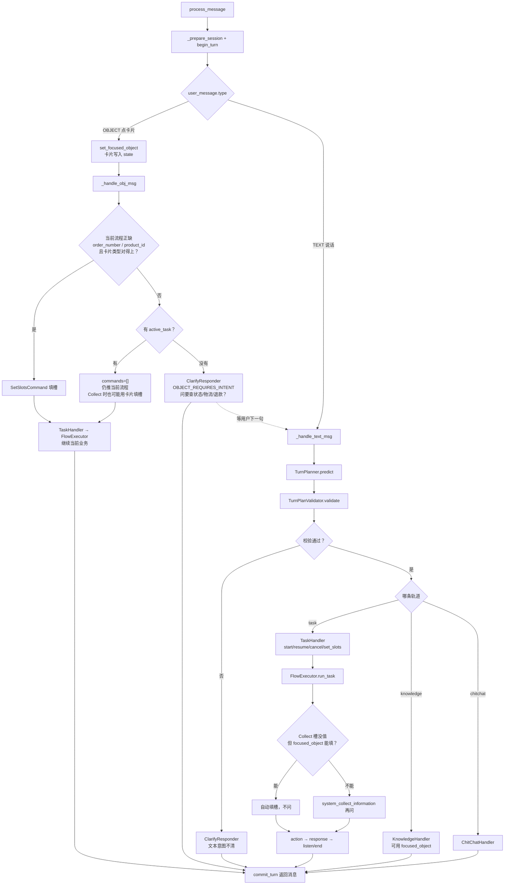

# DialogueEngine 消息路径

入口：`process_message`。文本走 Planner，点卡片走对象分支；对象消息**不会**改成文本。

## 完整流程

## 怎么记

1. **点卡片当轮**：能填槽就填并继续；有任务就接着跑；没任务才反问。全程都在 OBJECT。
2. **反问之后**：用户下一句才进 TEXT → Planner；上一张卡还在，开了查物流/查订单后尽量自动填槽。

## 点卡片当轮三条路

| 当时状态 | 走哪 | 会不会澄清 |
|---|---|---|
| 正在查订单/物流，正缺对应槽，卡片类型对得上 | `SetSlotsCommand` → 继续当前流程 | 否 |
| 有 `active_task`，槽对不上或不缺这个槽 | 空 commands，继续推当前流程 | 否 |
| 没有 `active_task` | `OBJECT_REQUIRES_INTENT` 澄清 | 是 |
