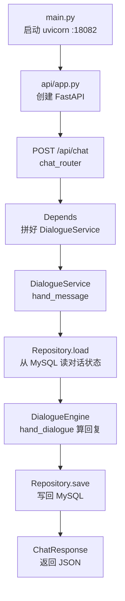

# 电商客服后端链路说明（/api/chat）

> 面向后端学习：理解一次聊天请求在后端是怎么走完的。

## 总览图



## 1. 入口：谁把服务拉起来

- 文件：`atguigu/main.py`
- 作用：用 uvicorn 加载 `api.app:app`
- 端口：来自配置（当前是 `18082`）
- `api/app.py`：创建 FastAPI、挂路由，启动时初始化数据库连接池

## 2. 接口层：只负责「收发快递」

- 文件：`atguigu/api/router/chat_router.py`
- 做三件事：
  1. 接收前端的 `ChatRequest`（JSON）
  2. 转成内部领域模型 `UserMessage`
  3. 调用 Service，再把结果转成 `ChatResponse` 返回

**原则：这一层不写业务逻辑，只做数据格式转换。**

## 3. 依赖注入：Service 是怎么来的

路由里写的是：

```python
service: DialogueService = Depends(get_dialogue_service)
```

FastAPI 会按 `api/dependencies.py` 自动装配：

```text
get_session()
   └─→ DialogueStateRepository
get_engine()
   └─→ DialogueEngine
两者一起
   └─→ DialogueService
```

你不用自己 `new`，框架帮你把「能干活的对象」塞进接口。

> 注意：不要写 `Depends(DialogueService)`。  
> 那样 FastAPI 会去解析构造函数参数，把 Repository 当成请求字段，容易报错。

## 4. 业务层：真正的办事顺序

- 文件：`atguigu/service/dialogue_service.py`
- 核心方法：`hand_message`

| 步骤 | 谁做 | 干什么 |
|------|------|--------|
| 1 | Repository | `load(sender_id)` 读对话状态 |
| 2 | Engine | `hand_dialogue(...)` 算出要回什么 |
| 3 | Repository | `save(...)` 把状态写回库 |

当前 Engine 还是占位实现：直接返回两句固定话。  
以后 LLM / Flow 流程会放在 Engine 里。

## 5. 一句话记住分层

```text
Router（接口） → Service（流程编排） → Repository（存取） / Engine（计算）
```

| 层 | 职责 |
|----|------|
| Router | 对外协议：收请求、回响应 |
| Service | 先干啥后干啥：编排流程 |
| Repository | 只碰数据库 |
| Engine | 只算业务结果 |

## 相关文件速查

| 文件 | 作用 |
|------|------|
| `atguigu/main.py` | 启动服务 |
| `atguigu/api/app.py` | FastAPI 应用 |
| `atguigu/api/router/chat_router.py` | `/api/chat` 接口 |
| `atguigu/api/dependencies.py` | 依赖装配 |
| `atguigu/api/schema.py` | 请求/响应模型 |
| `atguigu/service/dialogue_service.py` | 业务编排 |
| `atguigu/repository/dialogue_state_repository.py` | 对话状态读写 |
| `atguigu/engine/dialogue_engine.py` | 对话计算 |

## 和前端的关系（补充）

浏览器访问：`http://127.0.0.1:5173/api/chat`  
Vite 代理把 `/api` 转到：`http://127.0.0.1:18082/api/chat`  
所以前端看起来是同源，实际请求打到了后端 18082。
