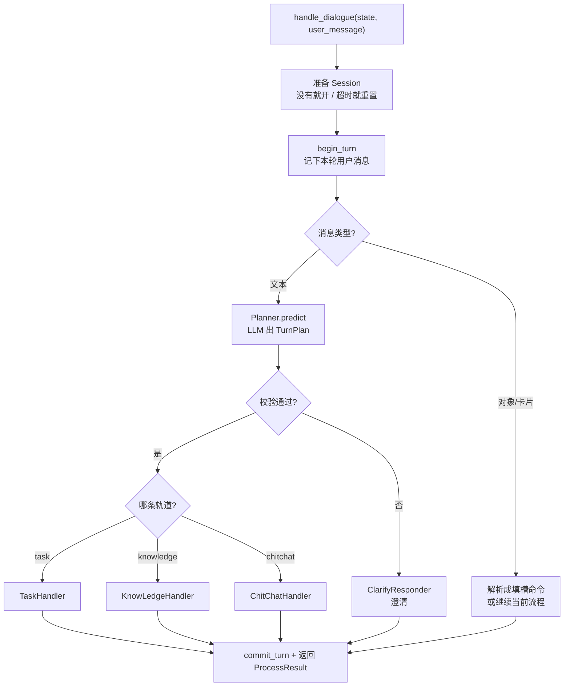

# 对话引擎说明（DialogueEngine）

> 引擎自己不算业务，只负责调度。真正干活的是 Planner / Validator / 三个 Handler。

---

## 1. 引擎在整条链路里的位置

```text
Service：读库 → 叫引擎 → 写库
Engine ：拿到 DialogueState + UserMessage，算出 BotMessage 列表
```

| 层 | 职责 |
|----|------|
| `DialogueService` | IO：Repository load / save |
| `DialogueEngine` | 计算：本轮怎么回 |

相关文件：

- `atguigu/service/dialogue_service.py`
- `atguigu/engine/dialogue_engine.py`
- `atguigu/engine/builder.py`

---

## 2. 引擎身上挂了哪些组件

`builder.py` 在应用启动时组装整支队伍，塞进 `DialogueEngine`：

| 组件 | 文件 | 干什么 |
|------|------|--------|
| `TurnPlanner` | `plan/planner.py` | 调 LLM，判断走哪条轨道 |
| `TurnPlanValidator` | `plan/turn_validator.py` | 校验 LLM 结果是否合法 |
| `ClarifyResponder` | `clarify/responder.py` | 不合法 → 反问澄清 |
| `TaskHandler` | `task/handler.py` | 业务流（查订单、退款等 YAML 流程） |
| `KnowLedgeHandler` | `knowledge/handler.py` | 知识咨询（政策、商品信息） |
| `ChitChatHandler` | `chitchat/handler.py` | 闲聊 |

一句话：**引擎 = 调度中心；Handler = 执行者。**

---

## 3. 一轮对话引擎怎么走



### 文本消息的核心三步

1. **规划** `turn_planner.predict` → 得到 `TurnPlan`
2. **校验** `turn_validator.validate` → 不行就澄清
3. **分流** → 交给对应 Handler

对应代码入口：`DialogueEngine.handle_dialogue` → `_handle_text_msg` / `_handle_obj_msg`。

---

## 4. TurnPlan：三条轨道

LLM 输出被收成三种轨道之一（见 `plan/turn_plan.py`）：

```text
TurnPlan
 ├─ task       → 要跑业务流程（带 commands）
 ├─ knowledge  → 要查知识（带 intents）
 └─ chitchat   → 闲聊
```

引擎根据哪个字段非空，决定叫谁：

```python
if turn_plan.task is not None:
    return await self.task_handler.handle(...)
elif turn_plan.knowledge is not None:
    return await self.knowledge_handler.handle(...)
else:
    return await self.chit_chat_handler.handle(...)
```

---

## 5. 和流程 YAML 的关系

1. 启动时 `FlowLoader` 加载 `flow-config/system_flows.yml`、`user_flows.yml`
2. 得到 `FlowsList`，塞进 `TaskHandler`
3. **只有走 task 轨道时**才会执行这些流程步骤
4. 闲聊 / 知识咨询不走 YAML 步骤图

注意：本项目目录名是 `flow_config`（连字符），不是参考项目里的 `flow_config`。

---

## 6. 容易混的两个 Session

| 名字 | 含义 | 谁用 |
|------|------|------|
| SQLAlchemy `AsyncSession` | 数据库连接 | Repository |
| `DialogueState` 里的 Session | 业务会话（多轮对话、超时） | Engine `_prepare_session` |

引擎里的 Session **不是**数据库 Session。

---

## 7. 对象消息（点卡片）怎么处理

用户点订单/商品卡片时走 `_handle_obj_msg`：

1. 尝试解析成填槽命令（如 `order_number` / `product_id`）
2. 有命令 → 交给 `TaskHandler` 继续流程
3. 已有活跃任务 → 继续跑任务
4. 否则 → `ClarifyResponder` 澄清意图

---

## 8. 一句话收束

```text
用户说话
  → Planner 判断轨道
  → Validator 把关
  → 三个 Handler 之一执行
  → 引擎打包成 ProcessResult 交回 Service 落库
```

---

## 相关文件速查

| 文件 | 作用 |
|------|------|
| `engine/builder.py` | 组装引擎及全部依赖 |
| `engine/dialogue_engine.py` | 调度主流程 |
| `plan/planner.py` | 意图规划（调 LLM） |
| `plan/turn_plan.py` | TurnPlan / 澄清原因枚举 |
| `plan/turn_validator.py` | 校验 TurnPlan |
| `task/handler.py` | 业务任务轨道 |
| `knowledge/handler.py` | 知识咨询轨道 |
| `chitchat/handler.py` | 闲聊轨道 |
| `clarify/responder.py` | 意图澄清 |
| `flow-config/*.yml` | 业务流程定义 |
