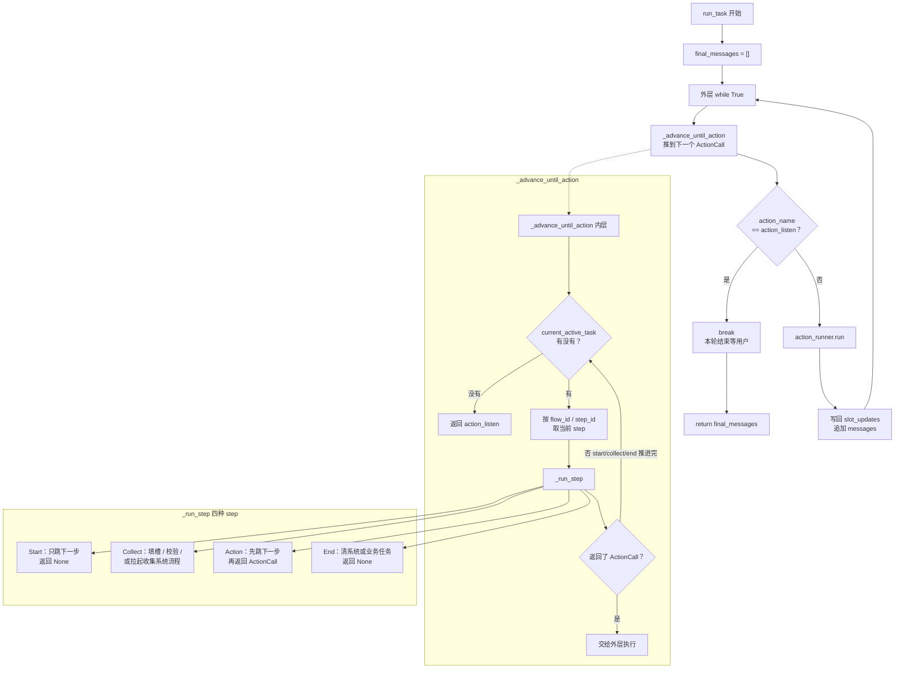
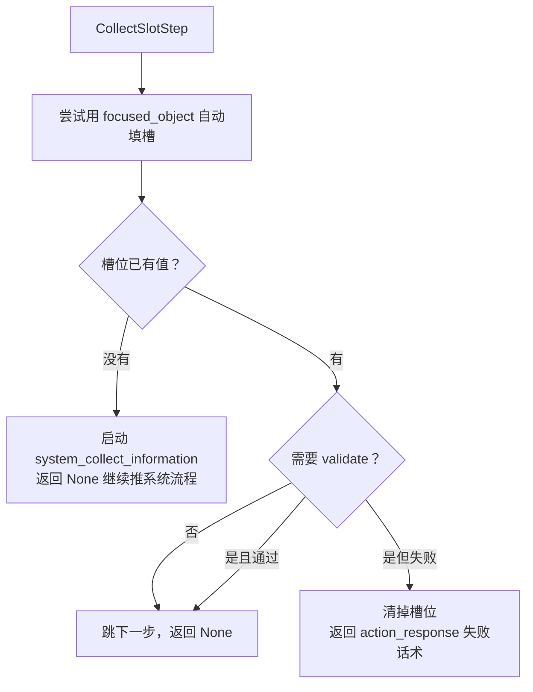

# FlowExecutor 执行逻辑

`FlowExecutor` 负责推进 YAML 中定义的**业务任务流程**和**系统任务流程**。整体分两层：

1. **外层 `run_task`**：循环拿到 `ActionCall` 并执行，遇到 `action_listen` 停下来等用户
2. **内层 `_advance_until_action`**：把当前 step 一直往下推，直到得到一个真正的 Action

## 总览

## CollectSlotStep 细节

## 怎么记

1. **外层**：拿到非 `listen` 的 action 就执行；`listen` 就停，把已收集的消息返回给用户
2. **内层**：`Start` / 已填好的 `Collect` / `End` 返回 `None`，继续往下走，直到碰到真正的 Action
3. **优先级**：`current_active_task()` 先系统任务、再业务任务，所以收集信息的系统流程会插队跑完再回来

## 关键方法

| 方法 | 作用 |
|---|---|
| `run_task` | 外层循环：推进流程并执行 action，直到 `action_listen` |
| `_advance_until_action` | 内层循环：推 step，直到得到 `ActionCall` |
| `_run_step` | 按 step 类型分发到 start / collect / action / end |
| `_advance_next_step` | 根据 link 选下一步，更新上下文里的 `step_id` |
| `_select_next_step` | 解析 `StaticLink` / `ConditionalLink` / `FallbackLink` |
| `_run_collect_slots_step` | 填槽、校验，或拉起 `system_collect_information` |
| `_run_action_step` | 先跳下一步，再构造并返回 `ActionCall` |
| `_run_end_step` | 结束系统任务或业务任务 |

## 为什么遇到 action_listen 要跳出

`action_listen` 表示：**这一轮机器人侧能做的事做完了，该等用户再说了**。

如果不 `break`，`while True` 会在同一次请求里空转。正确做法是停推进、返回 `final_messages`，等下一条用户消息再继续。
